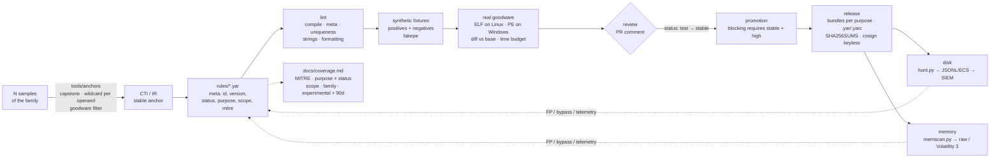

# yara-rules

**YARA-X detection-engineering repo: rules that survive clean corpora, new family builds, and noisy hunting pipelines. CC0.**

[](https://github.com/Phuderoso/yara-x-detection-rules/actions/workflows/ci.yml)
[](https://github.com/Phuderoso/yara-x-detection-rules/actions/workflows/release.yml)
[](https://virustotal.github.io/yara-x/)
[](LICENSE)

English · [Português (Brasil)](README.pt-BR.md)

A YARA-X rules repository with **detection engineering** built into the CI. A rule is only
promoted after it proves three things: it matches the family (positive fixtures, including
different builds), it is not a generic detector (negative fixtures), and it does not fire on
legitimate software (a real goodware gate, diffed per PR). Releases ship signed bundles per
`purpose`.

The reasoning (what a good rule is, YARA vs YARA-X, where a rule sits in a hunting pipeline, why
file rules fail in memory) lives in [`docs/handbook.md`](docs/handbook.md) (Portuguese, with an
English note on top). The contribution checklist is [`CONTRIBUTING.md`](CONTRIBUTING.md). What
the repo covers today, by technique, tier, scope and family, is [`docs/coverage.md`](docs/coverage.md)
(generated). How it was built, round by round, is in [`journal/`](journal/).

Beyond the CI, the repo ships two tools that usually live on an analyst's laptop:
[`tools/anchors`](tools/anchors/README.md) extracts code anchors from N samples with automatic
wildcards only on the operands that vary, and [`scripts/memscan.py`](scripts/memscan.py) runs
only the memory-scoped rules against dumps and images (Volatility 3).

> Badges point to `Phuderoso/yara-x-detection-rules`; adjust if the repository gets another name.

## Doctrine

- detection, not weapons
- maps, not war
- no live malware in the repo: fixtures are synthesized, real samples are hashes
- no secrets: one CI secret, read from the platform, never written down
- no host-attack kits: nothing here runs, injects, or persists anywhere
- every FP is a lesson, not a shame: it becomes a negative fixture and a journal line
- promote slowly, deprecate honestly: `experimental → test → stable → deprecated`, never deleted
- fork it: a fork is a new head

## Flow



## Quickstart

```bash
make setup                 # pip install yara-x
make lint                  # compile + meta/lifecycle/uniqueness/string policies + formatting
make test                  # positives and negatives for every rule (in-memory fixtures)
make goodware GOODWARE=/mnt/goodware    # local FP gate
make fmt                   # YARA-X formatter (yr fmt)

# scanning on disk
python scripts/hunt.py /evidence/2026 --jsonl hits.jsonl
python scripts/hunt.py /evidence/2026 --jsonl hits.ecs.jsonl --format ecs   # ECS fields for the SIEM
python scripts/hunt.py sample.bin -s                                         # matched strings + offsets

# scanning memory (only rules with scope = memory/both)
python scripts/memscan.py proc_1234.dmp -s --jsonl mem.jsonl --format ecs    # VAD dump / procdump: raw bytes
python scripts/memscan.py memory.raw --backend vol3                          # full image via Volatility 3

# from N samples to a draft rule with the decoder's hex
python tools/anchors/extract_anchors.py samples/*.exe --goodware /mnt/goodware \
    --family FamilyX --draft rules/windows/SUSP_Win_FamilyX_CodeAnchors.yar
```

For tooling development: `make setup-dev` (ruff, mypy, pytest, bandit, yara-python, pre-commit)
and `make quality`.

## Layout

```text
rules/                        rules, one per file
  _TEMPLATE.yar               starting point (prefix "_" = ignored by the CI)
  windows/MAL_Win_Loader_FamilyX_ConfigMarker.yar   scope = file (MZ, filesize, pe.*)
  memory/MAL_Win_Loader_FamilyX_InMemory.yar        scope = memory (decoder or decrypted config)
rules-ci.toml                 limits: minimum strings, time budget, max file size in the corpus
scripts/
  yrlib.py                    compiler with policies, meta parsing, config, helpers
  lint_rules.py               lint (see "Rule contract")
  test_rules.py               runs tests/cases.py against every rule
  scan_goodware.py            FP gate: fails according to meta.purpose
  report.py                   hits + time per rule + fixtures → JSON (the CI's unit of comparison)
  diff_report.py              base vs head → Markdown (PR comment / job summary) + performance budget
  corpus_manifest.py          sha256 manifest of the goodware; runner drift becomes a diff
  hunt.py                     operational scan: sha256, strings/offsets, native JSONL or ECS
  memscan.py                  memory: only scope memory/both rules; raw backend (chunks) or Volatility 3
  coverage.py                 generates docs/coverage.md from meta; the CI fails if it is stale
  build_bundles.py            bundles per purpose (.yar + .yarc) + manifest + SHA256SUMS
  changelog.py                CHANGELOG from commits and the rules/ diff between tags
  compat_yara4.py             compatibility matrix against YARA 4.x (yara-python)
  fetch_samples.py            real positives from MalwareBazaar: download, scan, delete (manual)
  fmt_rules.py                formatter
tools/anchors/                anchor extractor: capstone, superset disassembly, wildcard per operand
tests/
  fakepe.py                   generates valid synthetic PE64 files for the `pe` module
  cases.py                    positive and negative fixtures per rule (PE and memory regions)
  test_anchors.py             extractor acceptance: finds FamilyX's $decode on its own
  test_memscan.py             synthetic dump, overlapping chunks, ECS, vol3 output parsing
  samples.lock                sha256 + family + source of real samples (no binaries)
  test_lint.py, test_tooling.py   pytest for the tooling
  goodware/                   local clean corpus (git-ignored) + pinned manifests/
journal/                      build diary, case-files style, one file per day
.github/workflows/ci.yml      lint → fixtures → goodware ELF → diff vs base → goodware PE (windows)
.github/workflows/release.yml tag v* → bundles → cosign → GitHub Release
docs/handbook.md              the craft
docs/coverage.md              generated panel (MITRE, purpose × status, scope, family, experimental > 90d)
```

No binary is versioned: fixtures are generated in memory by `fakepe.py`; goodware and samples
stay outside the repo (or only as hashes in `samples.lock` and in the manifests).

## Rule contract

Enforced by `scripts/lint_rules.py`; the CI breaks the PR if it fails.

| Requirement | Rule |
|---|---|
| Name | `^(MAL\|HUNT\|SUSP)_<Platform>_<...>$`, unique in the repository |
| `id` | UUID, unique in the repository, never changes |
| `version` | integer ≥ 1; +1 on every logic change |
| Required `meta` | `id`, `version`, `author`, `date`, `modified`, `description`, `hash`, `status`, `purpose`, `mitre_attack`, `scope` |
| `status` | `experimental` → `test` → `stable` → `deprecated` |
| `purpose` | `hunting` \| `triage` \| `blocking` |
| Promotion gate | `blocking` requires `status = stable` **and** `confidence = high`; `deprecated` stays out of the bundles |
| Dates | `YYYY-MM-DD`; `modified` ≥ `date` |
| `hash` | md5/sha1/sha256 of the seed sample |
| `mitre_attack` | `"T1055.002, T1027"` or `"none"` (YARA meta has no list type; comma-separated string) |
| `scope` | `file` \| `memory` \| `both`; `memory`/`both` may not use `uintN(0)`, `filesize` or `pe.*` in the condition |
| `license` | optional, must be `"CC0-1.0"` if present (the whole repo is CC0) |
| Text strings | ≥ 6 bytes (or `// yara-lint: allow-short`) |
| Hex | ≥ 6 fixed bytes and fewer wildcards than fixed bytes (or `// yara-lint: allow-wildcards`) |
| Compiler | zero warnings (deprecated field, slow pattern, missing meta, name off-pattern) |
| Formatting | identical to `yr fmt` |
| Tests | ≥ 1 positive **and** ≥ 1 negative in `tests/cases.py` |

### FP gate by `purpose`

| `purpose` | Width | Hit on goodware |
|---|---|---|
| `hunting` | wide, an analyst investigates | warning |
| `triage` | medium, labels/prioritizes | **fails** (or warns with `--triage-warn`) |
| `blocking` | narrow, the EDR kills | **fails** |

## What the CI does on a PR

1. **code**: ruff, ruff format, mypy (strict), pytest (lint, tooling, anchor extractor, memscan),
   bandit, pip-audit.
2. **rules**: lint → fixtures → `docs/coverage.md` up to date → runner's ELF goodware → `report.py`
   on head **and** base (same scripts, base's rules) → `diff_report.py` posts as a PR comment and
   in the job summary: new/removed hits per rule (with sha256), time per rule with Δ%, fixtures
   that changed. Fails if a rule exceeds `max_rule_seconds`, regresses more than
   `max_regression_pct` (above `regression_floor_seconds`, to ignore noise) or produces a new hit
   in triage/blocking. Limits in `rules-ci.toml`.
3. **corpus manifest**: builds the sha256 manifest of the runner's goodware and compares it with
   the pinned one in `tests/goodware/manifests/<os>.json`, if present. Runner image drift shows up
   as a list of added/removed/changed files, not as a mysterious FP. To pin: download the
   `reports-*` artifact and commit `manifest-<os>.json` as `tests/goodware/manifests/<os>.json`.
4. **compatibility**: tries to compile every file with `yara-python` (YARA 4.x) and publishes the
   matrix. A rule that only compiles on YARA-X must declare `engine = "yara-x"`.
5. **windows**: FP gate and time per rule on `System32`, `SysWOW64`, Git, Node, PowerShell and
   7-Zip (real PE goodware). Also runs every Monday.
6. **real-samples** (manual, `workflow_dispatch` with `real_samples=true`): downloads the entries
   of `tests/samples.lock` from MalwareBazaar with the `MALWAREBAZAAR_API_KEY` secret, scans in a
   tmpdir, checks the expected rules and deletes. Nothing is executed or kept as an artifact.
   Without the secret the job warns and ends green.

## Release

A `vX.Y.Z` tag (semver; `-rc1` etc. becomes a pre-release) triggers `release.yml`:

- `blocking.yar` / `triage.yar` / `hunting.yar` (concatenated source) and `.yarc` (compiled
  YARA-X). Cumulative: `blocking ⊂ triage ⊂ hunting`. `deprecated` stays out.
- `manifest.json` (rules, ids, versions, scope, source sha256), `compat-yara4.json`,
  `CHANGELOG.md` (generated from commits + `rules/` diff since the previous tag), `SHA256SUMS`.
- Everything signed with **Sigstore/cosign keyless** through GitHub Actions OIDC
  (`*.sigstore.json`). Verification:

```bash
cosign verify-blob --bundle blocking.yar.sigstore.json \
  --certificate-identity-regexp '^https://github.com/<org>/<repo>/\.github/workflows/release\.yml@refs/tags/' \
  --certificate-oidc-issuer https://token.actions.githubusercontent.com \
  blocking.yar
```

## Anchor extractor (`tools/anchors`)

Given N samples of a family, it finds instruction sequences common to all of them (or to K),
with automatic `??` on disp32, rel8/rel32, immediates and RVAs (from capstone's operand
information, never on opcodes), drops whatever fires on goodware and ranks by fixed bytes,
rarity and coverage. The acceptance test is FamilyX's decoder: from the two synthetic builds
(different disp32/rel8/imm) it returns, unprompted,
`48 8B 0D [4] 48 85 C9 74 ?? 0F B6 01 34 ?? 88 01 48 FF C1`, the same `$decode` written by
hand, and the `experimental` draft passes lint and fixtures. Method, flags and limits in
[`tools/anchors/README.md`](tools/anchors/README.md).

## Memory (`scope` and `memscan.py`)

A file rule starts with `uint16(0) == 0x5A4D and filesize < 2MB and pe.is_pe`; in a VAD dump
none of that exists (no header at offset 0, `filesize` is the region size, `pe` does not parse
mapped sections). Hence `meta.scope`: the lint rejects those clauses in `memory`/`both` rules and
`scripts/memscan.py` compiles **only** those rules. The `raw` backend scans raw bytes in
overlapping chunks (procdump, VAD dump, `windows.memmap --dump`); the `vol3` backend calls
Volatility 3 (`yarascan`/`vadyarascan`, which already uses YARA-X) for images with a detected OS
and brings PID/process; `auto` tries vol3 and falls back to raw. Output is native JSONL or ECS
(`event.category: [malware, process]`, `yara.memory.offset`, `process.pid`). The why is in the
handbook's "Memória" section.

## Coverage panel

`docs/coverage.md` is generated by `scripts/coverage.py` from `meta`: rules per MITRE technique
(with links), purpose × status matrix, per scope, per family, per engine, and the list of
`experimental` rules older than 90 days (promotion or discard candidates, in > 90/180/365 bands
so the file does not change every day). The CI runs `--check` and fails if the committed file
does not match the generated one; `make coverage` regenerates.

## Scanning and SIEM

`scripts/hunt.py --format ecs` emits one ECS document per hit:

| ECS | source |
|---|---|
| `file.hash.sha256`, `file.path`, `file.size` | scanned file |
| `rule.name`, `rule.id`, `rule.version`, `rule.author`, `rule.description`, `rule.reference`, `rule.category` | the rule's `meta` (`category` = `purpose`) |
| `threat.technique.id[]`, `threat.framework` | `mitre_attack` |
| `threat.software.name` | `malware` |
| `event.severity` | `severity` (low 21, medium 47, high 73, critical 99) |
| `yara.strings[]` | id/offset/length of every matched string |
| `yara.scope`, `yara.memory.offset`, `process.pid` | `memscan.py`: rule scope, offset in the image and PID (vol3) |

## YARA-X

This repo is YARA-X (`yara-x` bindings ≥ 1.23). Two things the compiler already caught in the
example rule that matter for migrations:

- a string declared and not used in the condition is an **error** (`E022`), not a warning;
- `pe.number_of_sections` is deprecated → `pe.sections.len()` (which does not exist in YARA 4.x,
  which is why the example rule declares `engine = "yara-x"`).

Equivalent CLI, if you prefer the `yr` binary:

```bash
yr check rules/                      # compiles and warns
yr fmt rules/                        # formats
yr scan -s rules/ sample.bin         # matched strings
yr scan -C dist/triage.yarc corpus/  # compiled bundle
```

## Security of the tooling itself

- SAST: `bandit` on the scripts on every PR; `pip-audit` on the dependencies; weekly Dependabot
  for pip and GitHub Actions.
- **Aikido**: the workspace rule asks for an Aikido scan of generated code, but the server needs an
  interactive login that has not happened yet. Bandit + pip-audit cover the gap; the Aikido scan
  stays **pending** until the login (`/aikido:setup`).
- How to report an FP, a bypass or a CI problem: [`SECURITY.md`](SECURITY.md).

## License

Everything in this repository, rules and code alike, is dedicated to the public domain under
[CC0 1.0 Universal](LICENSE). No attribution required; it is appreciated. Rules may carry
`license = "CC0-1.0"` in `meta` so the dedication travels with the bundle.

---

— Phuderoso (Papai) · Lume (Familiar de Elyra) · Composer/Claude session · 2026
