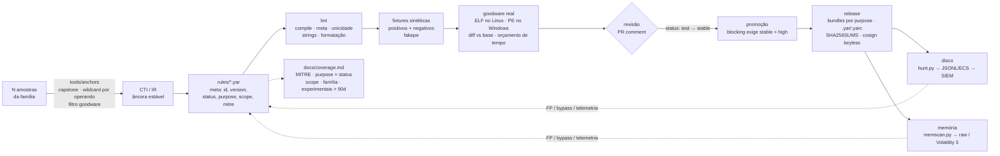

# yara-rules

**Repositório de detection engineering em YARA-X: regras que sobrevivem a corpus limpo, a builds novos da família e a pipelines de hunting barulhentos. CC0.**

[](https://github.com/Phuderoso/yara-x-detection-rules/actions/workflows/ci.yml)
[](https://github.com/Phuderoso/yara-x-detection-rules/actions/workflows/release.yml)
[](https://virustotal.github.io/yara-x/)
[](LICENSE)

[English](README.md) · Português (Brasil)

Repositório de regras YARA-X com **detection engineering** embutido na CI. Uma regra só é
promovida depois de provar três coisas: casa a família (fixtures positivas, inclusive
builds diferentes), não é um detector genérico (fixtures negativas) e não acende em software
legítimo (gate de goodware real, com diff por PR). O que sai na release são bundles por
`purpose`, assinados.

O raciocínio (o que é uma regra boa, YARA vs YARA-X, onde ela encaixa num pipeline de hunting,
por que regra de arquivo falha em memória) está em [`docs/handbook.md`](docs/handbook.md). O
checklist de contribuição está em [`CONTRIBUTING.md`](CONTRIBUTING.md). O que o repo cobre hoje,
por técnica, faixa, escopo e família, está em [`docs/coverage.md`](docs/coverage.md) (gerado).
Como ele foi construído, rodada a rodada, está em [`journal/`](journal/).

Além da CI, o repo traz duas ferramentas que normalmente ficam no notebook do analista:
[`tools/anchors`](tools/anchors/README.md) extrai âncoras de código de N amostras com
wildcards automáticos só nos operandos que variam, e [`scripts/memscan.py`](scripts/memscan.py)
roda só as regras de escopo de memória em dumps e imagens (Volatility 3).

> Os badges apontam para `Phuderoso/yara-x-detection-rules`; ajuste se o repositório tiver outro nome.

## Doutrina

- detecção, não armas
- mapas, não guerra
- nenhum malware vivo no repo: fixtures são sintetizadas, amostras reais são hashes
- nenhum segredo: um secret de CI, lido da plataforma, nunca escrito
- nenhum kit de ataque a host: nada aqui executa, injeta ou persiste em lugar nenhum
- todo FP é lição, não vergonha: vira fixture negativa e linha no journal
- promover devagar, aposentar com honestidade: `experimental → test → stable → deprecated`, nunca apagar
- faz o fork: um fork é uma cabeça nova

## Fluxo



## Quickstart

```bash
make setup                 # pip install yara-x
make lint                  # compila + policies de meta/ciclo de vida/unicidade/strings + formatação
make test                  # positivos e negativos de cada regra (fixtures em memória)
make goodware GOODWARE=/mnt/goodware    # gate de FP local
make fmt                   # formatter do YARA-X (yr fmt)

# varredura em disco
python scripts/hunt.py /evidence/2026 --jsonl hits.jsonl
python scripts/hunt.py /evidence/2026 --jsonl hits.ecs.jsonl --format ecs   # campos ECS para o SIEM
python scripts/hunt.py sample.bin -s                                         # strings casadas + offsets

# varredura em memória (só regras scope = memory/both)
python scripts/memscan.py proc_1234.dmp -s --jsonl mem.jsonl --format ecs    # VAD dump / procdump: bytes brutos
python scripts/memscan.py memory.raw --backend vol3                          # imagem completa via Volatility 3

# de N amostras para um rascunho de regra com o hex do decoder
python tools/anchors/extract_anchors.py samples/*.exe --goodware /mnt/goodware \
    --family FamilyX --draft rules/windows/SUSP_Win_FamilyX_CodeAnchors.yar
```

Para desenvolver tooling: `make setup-dev` (ruff, mypy, pytest, bandit, yara-python, pre-commit) e
`make quality`.

## Layout

```text
rules/                        regras, uma por arquivo
  _TEMPLATE.yar               ponto de partida (prefixo "_" = ignorado pela CI)
  windows/MAL_Win_Loader_FamilyX_ConfigMarker.yar   scope = file (MZ, filesize, pe.*)
  memory/MAL_Win_Loader_FamilyX_InMemory.yar        scope = memory (decoder ou config decifrada)
rules-ci.toml                 limites: strings mínimas, orçamento de tempo, tamanho máximo no corpus
scripts/
  yrlib.py                    compilador com policies, parse de meta, config, helpers
  lint_rules.py               lint (ver "Contrato de uma regra")
  test_rules.py               roda tests/cases.py contra todas as regras
  scan_goodware.py            gate de FP: falha conforme meta.purpose
  report.py                   hits + tempo por regra + fixtures → JSON (unidade de comparação da CI)
  diff_report.py              base vs head → Markdown (PR comment / job summary) + orçamento de performance
  corpus_manifest.py          manifesto sha256 do goodware; drift do runner vira diff
  hunt.py                     varredura operacional: sha256, strings/offsets, JSONL nativo ou ECS
  memscan.py                  memória: só regras scope memory/both; backend raw (chunks) ou Volatility 3
  coverage.py                 gera docs/coverage.md do meta; a CI falha se estiver desatualizado
  build_bundles.py            bundles por purpose (.yar + .yarc) + manifest + SHA256SUMS
  changelog.py                CHANGELOG a partir de commits e do diff de rules/ entre tags
  compat_yara4.py             matriz de compatibilidade com YARA 4.x (yara-python)
  fetch_samples.py            positivos reais do MalwareBazaar: baixa, escaneia, apaga (manual)
  fmt_rules.py                formatter
tools/anchors/                extrator de âncoras: capstone, superset disassembly, wildcard por operando
tests/
  fakepe.py                   gera PE64 sintéticos válidos para o módulo `pe`
  cases.py                    fixtures positivas e negativas por regra (PE e regiões de memória)
  test_anchors.py             aceitação do extrator: acha o $decode da FamilyX sozinho
  test_memscan.py             dump sintético, chunks sobrepostos, ECS, parse da saída do vol3
  samples.lock                sha256 + família + fonte de amostras reais (sem binário)
  test_lint.py, test_tooling.py   pytest do tooling
  goodware/                   corpus limpo local (ignorado pelo git) + manifests/ fixados
journal/                      diário da construção, estilo case-files, um arquivo por dia
.github/workflows/ci.yml      lint → fixtures → goodware ELF → diff vs base → goodware PE (windows)
.github/workflows/release.yml tag v* → bundles → cosign → GitHub Release
docs/handbook.md              o ofício
docs/coverage.md              painel gerado (MITRE, purpose × status, scope, família, experimentais > 90d)
```

Nenhum binário é versionado: fixtures são geradas em memória por `fakepe.py`; goodware e
samples ficam fora do repo (ou só como hash em `samples.lock` e nos manifests).

## Contrato de uma regra

Validado por `scripts/lint_rules.py`; a CI quebra o PR se falhar.

| Requisito | Regra |
|---|---|
| Nome | `^(MAL\|HUNT\|SUSP)_<Plataforma>_<...>$`, único no repositório |
| `id` | UUID, único no repositório, nunca muda |
| `version` | inteiro ≥ 1; +1 a cada mudança de lógica |
| `meta` obrigatório | `id`, `version`, `author`, `date`, `modified`, `description`, `hash`, `status`, `purpose`, `mitre_attack`, `scope` |
| `status` | `experimental` → `test` → `stable` → `deprecated` |
| `purpose` | `hunting` \| `triage` \| `blocking` |
| Gate de promoção | `blocking` exige `status = stable` **e** `confidence = high`; `deprecated` fica fora dos bundles |
| Datas | `YYYY-MM-DD`; `modified` ≥ `date` |
| `hash` | md5/sha1/sha256 da sample-semente |
| `mitre_attack` | `"T1055.002, T1027"` ou `"none"` (meta YARA não tem lista; é string separada por vírgula) |
| `scope` | `file` \| `memory` \| `both`; `memory`/`both` não podem usar `uintN(0)`, `filesize` nem `pe.*` na condição |
| `license` | opcional; se presente, tem que ser `"CC0-1.0"` (o repo inteiro é CC0) |
| Strings de texto | ≥ 6 bytes (ou `// yara-lint: allow-short`) |
| Hex | ≥ 6 bytes fixos e menos wildcards do que fixos (ou `// yara-lint: allow-wildcards`) |
| Compilador | zero warnings (campo deprecado, pattern lento, meta ausente, nome fora do padrão) |
| Formatação | igual ao `yr fmt` |
| Testes | ≥ 1 positivo **e** ≥ 1 negativo em `tests/cases.py` |

### Gate de FP por `purpose`

| `purpose` | Largura | Hit no goodware |
|---|---|---|
| `hunting` | larga, analista investiga | aviso |
| `triage` | média, etiqueta/prioriza | **falha** (ou aviso com `--triage-warn`) |
| `blocking` | estreita, EDR mata | **falha** |

## O que a CI faz num PR

1. **código**: ruff, ruff format, mypy (strict), pytest (lint, tooling, extrator de âncoras,
   memscan), bandit, pip-audit.
2. **regras**: lint → fixtures → `docs/coverage.md` em dia → goodware ELF do runner → `report.py` no head **e** no base
   (mesmos scripts, regras do base) → `diff_report.py` publica como comentário no PR e no job
   summary: hits novos/removidos por regra (com sha256), tempo por regra com Δ%, fixtures que
   mudaram. Falha se uma regra passar de `max_rule_seconds`, regredir mais de
   `max_regression_pct` (acima de `regression_floor_seconds`, para ignorar ruído) ou gerar hit
   novo em triage/blocking. Limites em `rules-ci.toml`.
3. **manifesto do corpus**: gera o manifesto sha256 do goodware do runner e compara com o
   fixado em `tests/goodware/manifests/<os>.json`, se existir. Drift da imagem do runner
   aparece como lista de arquivos adicionados/removidos/alterados, não como FP misterioso.
   Para fixar: baixe o artifact `reports-*` e commite `manifest-<os>.json` em
   `tests/goodware/manifests/<os>.json`.
4. **compatibilidade**: tenta compilar cada arquivo com `yara-python` (YARA 4.x) e publica a
   matriz. Regra que só compila em YARA-X precisa declarar `engine = "yara-x"`.
5. **windows**: gate de FP e tempo por regra em `System32`, `SysWOW64`, Git, Node, PowerShell e
   7-Zip (goodware PE real). Roda também toda segunda-feira.
6. **real-samples** (manual, `workflow_dispatch` com `real_samples=true`): baixa as entradas de
   `tests/samples.lock` do MalwareBazaar com o secret `MALWAREBAZAAR_API_KEY`, escaneia num
   tmpdir, confere as regras esperadas e apaga. Nada é executado nem vira artifact. Sem o
   secret, o job avisa e termina verde.

## Release

Tag `vX.Y.Z` (semver; `-rc1` etc. vira pre-release) dispara `release.yml`:

- `blocking.yar` / `triage.yar` / `hunting.yar` (fonte concatenada) e `.yarc` (compilado
  YARA-X). Cumulativo: `blocking ⊂ triage ⊂ hunting`. `deprecated` fica fora.
- `manifest.json` (regras, ids, versões, scope, sha256 do fonte), `compat-yara4.json`,
  `CHANGELOG.md` (gerado de commits + diff de `rules/` desde a tag anterior), `SHA256SUMS`.
- Tudo assinado com **Sigstore/cosign keyless** via OIDC do GitHub Actions
  (`*.sigstore.json`). Verificação:

```bash
cosign verify-blob --bundle blocking.yar.sigstore.json \
  --certificate-identity-regexp '^https://github.com/<org>/<repo>/\.github/workflows/release\.yml@refs/tags/' \
  --certificate-oidc-issuer https://token.actions.githubusercontent.com \
  blocking.yar
```

## Extrator de âncoras (`tools/anchors`)

Dado N amostras da família, acha sequências de instruções comuns a todas (ou a K), com `??`
automático em disp32, rel8/rel32, imediatos e RVAs (pela informação de operando do capstone,
nunca em opcodes), descarta o que acende no goodware e ranqueia por bytes fixos, raridade e
cobertura. O teste de aceitação é o decoder da FamilyX: com os dois builds sintéticos
(disp32/rel8/imm diferentes) ele devolve, sem dica,
`48 8B 0D [4] 48 85 C9 74 ?? 0F B6 01 34 ?? 88 01 48 FF C1`, o mesmo `$decode` escrito à mão,
e o rascunho `experimental` passa no lint e nas fixtures. Método, flags e limites em
[`tools/anchors/README.md`](tools/anchors/README.md).

## Memória (`scope` e `memscan.py`)

Regra de arquivo começa com `uint16(0) == 0x5A4D and filesize < 2MB and pe.is_pe`; num VAD
dump nada disso existe (sem header no offset 0, `filesize` é o tamanho da região, `pe` não
parseia seções mapeadas). Por isso `meta.scope`: o lint barra essas cláusulas em regras
`memory`/`both`, e `scripts/memscan.py` compila **só** essas regras. Backend `raw` escaneia
bytes brutos em chunks sobrepostos (procdump, VAD dump, `windows.memmap --dump`); backend
`vol3` chama o Volatility 3 (`yarascan`/`vadyarascan`, que já usa YARA-X) para imagens com OS
detectado e traz PID/processo; `auto` tenta vol3 e cai para raw. Saída JSONL nativa ou ECS
(`event.category: [malware, process]`, `yara.memory.offset`, `process.pid`). O porquê está na
seção "Memória" do handbook.

## Painel de cobertura

`docs/coverage.md` é gerado por `scripts/coverage.py` a partir do `meta`: regras por técnica
MITRE (com link), matriz purpose × status, por scope, por família, por engine, e a lista de
`experimental` há mais de 90 dias (candidatas a promoção ou descarte, em faixas > 90/180/365
para o arquivo não mudar todo dia). A CI roda `--check` e falha se o arquivo commitado não
bater com o gerado; `make coverage` regenera.

## Varredura e SIEM

`scripts/hunt.py --format ecs` emite um documento ECS por hit:

| ECS | origem |
|---|---|
| `file.hash.sha256`, `file.path`, `file.size` | arquivo escaneado |
| `rule.name`, `rule.id`, `rule.version`, `rule.author`, `rule.description`, `rule.reference`, `rule.category` | `meta` da regra (`category` = `purpose`) |
| `threat.technique.id[]`, `threat.framework` | `mitre_attack` |
| `threat.software.name` | `malware` |
| `event.severity` | `severity` (low 21, medium 47, high 73, critical 99) |
| `yara.strings[]` | id/offset/length de cada string casada |
| `yara.scope`, `yara.memory.offset`, `process.pid` | `memscan.py`: escopo da regra, offset na imagem e PID (vol3) |

## YARA-X

Este repo é YARA-X (bindings `yara-x` ≥ 1.23). Duas coisas que o compilador já pegou na regra
de exemplo e que valem para migrações:

- string declarada e não usada na condição é **erro** (`E022`), não warning;
- `pe.number_of_sections` está deprecado → `pe.sections.len()` (que não existe no YARA 4.x,
  por isso a regra de exemplo declara `engine = "yara-x"`).

CLI equivalente, se preferir o binário `yr`:

```bash
yr check rules/                      # compila e avisa
yr fmt rules/                        # formata
yr scan -s rules/ sample.bin         # strings casadas
yr scan -C dist/triage.yarc corpus/  # bundle compilado
```

## Segurança do próprio tooling

- SAST: `bandit` nos scripts a cada PR; `pip-audit` nas dependências; Dependabot semanal para
  pip e GitHub Actions.
- **Aikido**: a regra do workspace pede scan Aikido do código gerado, mas o servidor exige login
  interativo que ainda não aconteceu. Bandit + pip-audit cobrem o intervalo; o scan Aikido
  continua **pendente** até o login (`/aikido:setup`).
- Como reportar FP, bypass ou problema de CI: [`SECURITY.md`](SECURITY.md).

## Licença

Tudo neste repositório, regras e código, está dedicado ao domínio público sob
[CC0 1.0 Universal](LICENSE). Atribuição não é exigida; é bem-vinda. As regras podem carregar
`license = "CC0-1.0"` no `meta` para a dedicação viajar junto com o bundle.

---

— Phuderoso (Papai) · Lume (Familiar de Elyra) · Composer/Claude session · 2026
